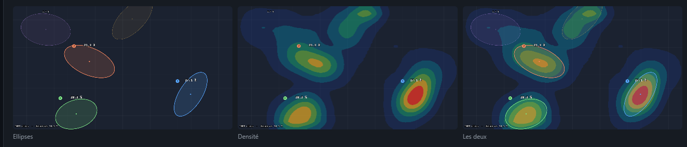
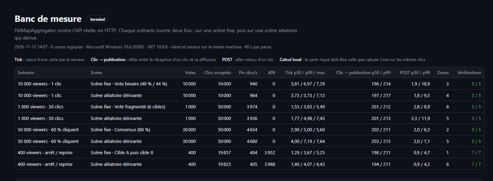
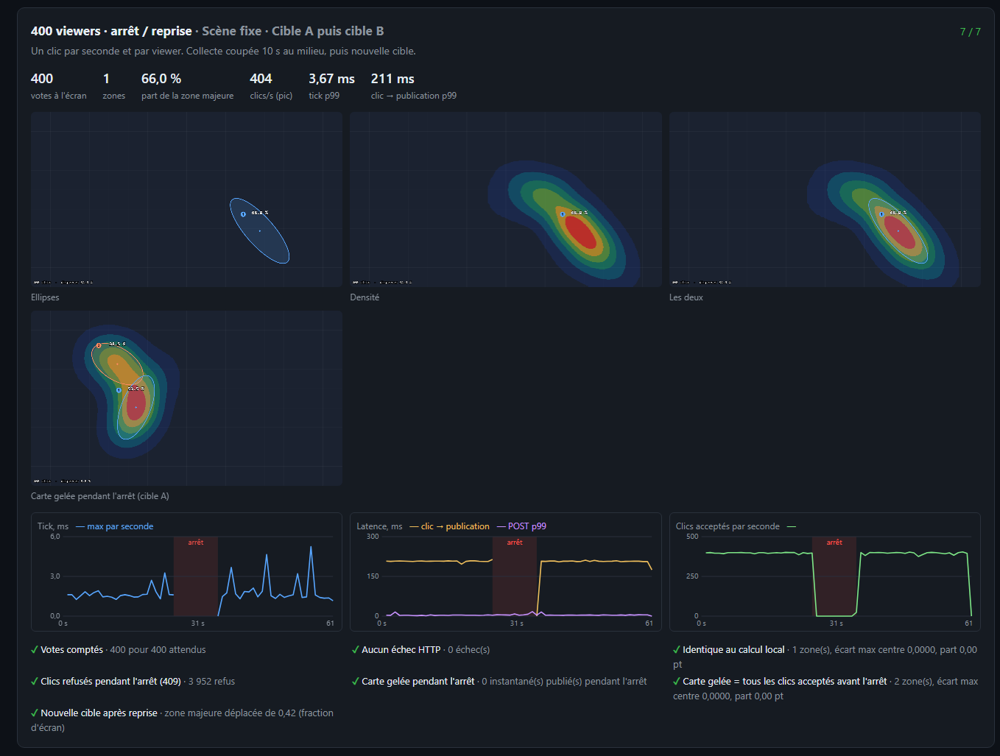

# HitMapAggregator

Extension Twitch : pendant un stream, les viewers cliquent sur l'image. Le serveur agrège
ces clics en zones d'intérêt avec leur pourcentage, et une browser source OBS les affiche
en incrustation sur le flux.



.NET 10, ASP.NET Core Minimal API, extension en HTML/JS sans framework. Conçu pour
5 000 à 10 000 viewers, mesuré jusqu'à 50 000.

## Sommaire

- [Fonctionnement](#fonctionnement)
- [Résultats du banc](#résultats-du-banc)
- [Choix techniques](#choix-techniques)
- [État du projet](#état-du-projet)
- [Démarrer](#démarrer)
- [Structure](#structure)
- [API](#api)
- [Extension Twitch](#extension-twitch)
- [Outils](#outils)

## Fonctionnement

```
viewer ──POST /api/clicks──▶ session du canal ──tick 200 ms──▶ carte ──SSE──▶ overlay OBS
 (JWT Twitch)                  dernier clic par viewer         champ 128×72        (browser source)
                                                               + zones triées
diffuseur ──/api/control/*──▶ start · stop · reset · réglages
```

1. Le viewer clique sur la vidéo. L'extension envoie la position normalisée `{ x, y }`
   avec le JWT fourni par Twitch.
2. Le serveur garde **le dernier clic de chaque viewer**, identifié par son
   `opaque_user_id` haché. Recliquer déplace un vote, ça n'en ajoute pas.
3. Toutes les 200 ms, une boucle par canal calcule un champ de densité 128×72, détecte
   les pics, en tire des zones (centre, ellipse de covariance, pourcentage) et publie le
   tout en Server-Sent Events.
4. L'overlay dessine les ellipses, le champ en bandes de niveau, ou les deux.

## Résultats du banc

Mesure de bout en bout : vrais POST HTTP, vrais JWT, carte reçue par SSE comme l'overlay.
Chaque scénario tourne sur une scène fixe puis sur une scène aléatoire qui dérive. Les
clics imitent une foule : cibles de forme irrégulière, chaque viewer vise son propre
point, arrivées par vagues, changements d'avis.



Pire valeur des deux scènes, client et serveur sur la même machine (Windows, 8 cœurs
logiques), 60 s par passe :

| Scénario | Votes | Pic clics/s | Tick p99 | Clic → publication p99 | POST p99 |
|---|---:|---:|---:|---:|---:|
| 10 000 viewers, 1 clic | 10 000 | 964 | 7,0 ms | 217 ms | 18,9 ms |
| 1 000 viewers, 50 clics | 1 000 | 3 974 | 5,0 ms | 213 ms | 11,9 ms |
| 50 000 viewers, 30 000 cliquent | 30 000 | 4 680 | 7,2 ms | 213 ms | 7,1 ms |
| 400 viewers, arrêt / reprise | 400 | 405 | 4,1 ms | 211 ms | 4,7 ms |

Aucun échec HTTP, 44 vérifications sur 44. Le délai clic → publication est borné par le
rythme du tick (200 ms) ; le calcul lui-même prend moins de 8 ms.

Pour chaque passe, le banc rejoue en local les clics acceptés avec `Core` et exige que la
carte reçue soit identique : ingestion, dédoublonnage, calcul, sérialisation et diffusion
sont vérifiés d'un bloc.



## Choix techniques

- **Ingestion HTTP sans état, diffusion SSE.** Les viewers ne reçoivent rien : un POST
  suffit, pas de WebSocket à tenir ouverts par milliers. L'overlay est le seul abonné
  de son canal.
- **Ingestion et diffusion découplées.** Un clic ne déclenche jamais d'envoi ; un timer
  par canal produit la carte. Le coût de diffusion ne dépend pas du nombre de clics.
- **Positions brutes stockées, jamais les cellules.** Changer un réglage (rendu,
  viewers anonymes) s'applique rétroactivement à tous les clics déjà reçus.
- **Flou séparable à somme glissante** : coût indépendant du rayon. Buffers du champ
  alloués une fois par canal : zéro allocation par tick.
- **Rien de ce qu'envoie le client n'est cru.** Canal et rôle viennent du JWT validé.
  L'URL de l'overlay porte un jeton HMAC révocable, jamais journalisé.
- **`Core` ne dépend pas d'ASP.NET** : toute la logique se teste sans serveur.

## État du projet

Fait :

- noyau de calcul, API, SSE, overlay, authentification Twitch ;
- 104 tests (unitaires, intégration, performance) ;
- banc de mesure et rapport ;
- page de configuration de l'extension validée dans Twitch (Local Test).

Reste avant une mise en production :

- tester le panneau live et l'overlay viewer pendant un vrai live ;
- héberger l'API derrière une adresse HTTPS fixe (rien de prévu pour l'instant), puis
  passer en hosted test et en revue Twitch ;
- les générations de jetons overlay sont dans un fichier local : une seule instance de
  serveur supposée.

## Démarrer

Prérequis : SDK .NET 10.

```
dotnet run --project src/HitMapAggregator.Api -c Release --urls http://localhost:5080
dotnet run --project tests/HitMapAggregator.Tests -c Release
```

`dotnet test` ne fonctionne pas sur la machine de développement (le SDK n'arrive pas à
dialoguer avec l'exécutable de test) : le projet de tests se lance directement, avec le
runner in-process de xUnit. `-notrait "Category=Performance"` exclut les mesures,
`-showLiveOutput` affiche les chiffres. Les tests de perf sont ignorés en Debug.

Overlay : `http://localhost:5080/overlay/?channel=<id>&token=<jeton>`, avec
`&mode=ellipse` ou `&mode=contour` pour forcer un rendu. L'URL complète s'obtient dans la
page de configuration de l'extension.

## Structure

```
src/HitMapAggregator.Core           logique métier pure (agrégation, sessions), sans ASP.NET
src/HitMapAggregator.Api            EBS : ingestion, pilotage, SSE, overlay (wwwroot/overlay)
tests/HitMapAggregator.Tests        tests unitaires, d'intégration et de performance
tests/HitMapAggregator.Testing      données synthétiques et JWT de test, partagés avec les outils
tools/HitMapAggregator.Traffic      trafic synthétique : simulate, load, bench
tools/HitMapAggregator.Visualizer   banc d'essai WinForms et export SVG
extension/                          pages de l'extension Twitch
```

Réglages communs dans `Directory.Build.props`, versions de paquets dans
`Directory.Packages.props`.

## API

```
POST  /api/clicks                        JWT viewer · 204 · 400 · 401 · 409 collecte fermée
GET   /api/control/state                 JWT diffuseur · running + réglages (crée la session)
POST  /api/control/start                 JWT diffuseur · ouvre la collecte, démarre le tick
POST  /api/control/stop                  JWT diffuseur · ferme la collecte, publie une dernière carte
POST  /api/control/reset                 JWT diffuseur · vide les positions
POST  /api/control/settings              JWT diffuseur · patch JSON partiel, possible avant start
GET   /api/control/overlay-token         JWT diffuseur · jeton overlay courant
POST  /api/control/overlay-token/rotate  JWT diffuseur · nouveau jeton, flux ouverts coupés
GET   /api/stream/heatmap                ?channelId=&token= · SSE, 401 si jeton invalide
GET   /api/metrics                       en-tête X-Metrics-Key · tick, âge du clic, débit
```

Le canal et l'`opaque_user_id` viennent toujours du JWT ; le corps d'un clic ne porte que
`{ x, y }`. `/api/control/*` est réservé au diffuseur, pas aux modérateurs. Un clic reçu
pendant l'arrêt est refusé en 409 : c'est le seul signal qu'un viewer reçoit du serveur.

### Secrets

Section `Secrets` :

- `TwitchExtension` : secret base64 de la console Twitch, vérifie les JWT ;
- `OverlayToken` : clé base64 propre au serveur, signe les jetons overlay ;
- `MetricsKey` : protège `/api/metrics`.

Les deux premiers font au moins 32 octets, le troisième au moins 16 caractères, sinon
l'API refuse de démarrer. Les valeurs de `appsettings.Development.json` sont des clés de
**développement**, publiques exprès : elles ne servent qu'en local et aux outils. Le vrai
secret Twitch et les clés d'un serveur exposé se passent par `dotnet user-secrets` ou des
variables d'environnement (`Secrets__TwitchExtension`…), jamais par le dépôt.

### Jeton overlay

HMAC(`OverlayToken`, canal + génération). Les générations sont persistées dans
`Overlay:GenerationsPath` (défaut `data/overlay-generations.json`) et relues au
démarrage. Un fichier illisible bloque le démarrage plutôt que de remettre les
générations à zéro. Régénérer coupe aussi les flux SSE ouverts. Limite connue : un flux
validé juste avant la rotation mais abonné juste après survit.

## Extension Twitch

Dossier `extension/` :

- `video_overlay.html` : clic viewer, positions relatives à l'image (bandes noires
  exclues), clics espacés d'au moins 250 ms, message sur 409 ;
- `config.html` : configuration hors live (URL OBS, réglages), depuis le gestionnaire
  d'extensions ;
- `live_config.html` : pilotage pendant le live (Démarrer, Arrêter, Nouvelle manche).

`control.js` est commun aux deux pages du diffuseur. CORS : origines
`https://*.ext-twitch.tv`, plus localhost en Development.

### Local Test

Chrome interdit à twitch.tv d'appeler `localhost` (Local Network Access). L'API est donc
exposée par un tunnel cloudflared, et sert elle-même `extension/` sous `/extension`
(Development seulement, sans cache) ; `config.js` prend `location.origin`.

1. Mettre en user-secrets le vrai `TwitchExtension` et des clés aléatoires pour
   `OverlayToken` et `MetricsKey`.
2. Lancer l'API (configuration `api-twitch` de `.claude/launch.json`), puis
   `.tools/cloudflared.exe tunnel --url http://localhost:5080` (dossier ignoré par git).
   Si conda impose `SSL_CERT_FILE` dans le shell, retirer cette variable pour cloudflared.
3. Dans la console Twitch, à refaire à chaque tunnel : URI de test de base =
   `https://<tunnel>/extension/`, et `https://<tunnel>` dans les domaines de
   récupération d'URL.

Tant que le tunnel tourne, l'API de développement est publique : le couper après le test.
En hosted test, les pages viennent du CDN Twitch : mettre l'URL absolue de l'EBS dans
`config.js`.

## Outils

### Banc de mesure

```
dotnet run --project tools/HitMapAggregator.Traffic -c Release -- bench
```

L'API tourne à part, en Release (`--url`, défaut `http://localhost:5080`). Quatre
scénarios, chacun sur une scène fixe puis aléatoire, 60 s par passe (`--duration`), un
canal neuf par passe, après un échauffement non compté :

- 10 000 viewers, 1 clic chacun ;
- 1 000 viewers, 50 clics chacun espacés de 250 ms (~4 000 clics/s) ;
- 50 000 viewers dont 30 000 cliquent, 5 000 d'entre eux 5 fois ;
- 400 viewers en continu, collecte coupée 10 s au milieu, nouvelle cible à la reprise.

Page en direct sur `http://localhost:5090/` (`--port`), rapport HTML autonome et JSON
dans `artifacts/bench/` (`--out`). `--only <10k|1k50|50k|400>` pour un seul scénario.
Code de sortie 2 si une vérification échoue. Les clics de foule viennent de
`Bench/Crowd.cs`.

Le banc signe ses JWT avec le secret de développement (`--secret`, `--metrics-key` pour
d'autres valeurs), et doit être le seul lecteur de `/api/metrics` pendant la mesure.

### Trafic synthétique

```
dotnet run --project tools/HitMapAggregator.Traffic -c Release -- simulate --url http://localhost:5080 --channel demo --scenario random --rate 3000 --duration 60
dotnet run --project tools/HitMapAggregator.Traffic -c Release -- load --url http://localhost:5080 --clients 20000
```

`simulate` : scénarios `random` (monde aléatoire qui dérive), `noise` ou les six jeux
figés. `load` : montée en charge NBomber puis verdict sur le p99 du tick (seuil 30 ms).
Mesurer sur un serveur chaud : un canal neuf paie la compilation JIT sur ses premiers
ticks.

NBomber est gratuit pour un usage personnel uniquement. Il tire MessagePack 2.5.302,
signalé par NuGet (GHSA-qhrr-8q5h-9q3h) : outil de développement, jamais déployé.

### Visualiseur

```
dotnet run --project tools/HitMapAggregator.Visualizer -c Release
dotnet run --project tools/HitMapAggregator.Visualizer -c Release -- shot artifacts/explorer.png
dotnet run --project tools/HitMapAggregator.Visualizer -c Release -- all artifacts/svg 20000
```

Sans argument : banc d'essai interactif sur un monde de clics dont les parts dérivent,
pour voir les classements s'inverser. `ZoneTracker` apparie les zones d'un tick à l'autre
pour tracer leurs parts dans le temps ; c'est un outil de diagnostic, l'overlay, lui,
reçoit un simple classement. `shot` produit une capture reproductible, `all` un SVG par
scénario synthétique, référence de non-régression. Cible `net10.0-windows` (WinForms).
